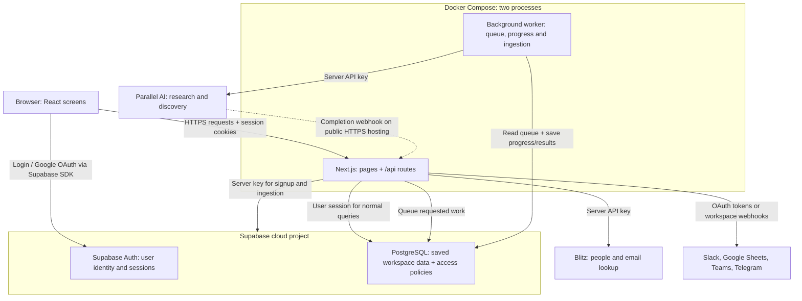
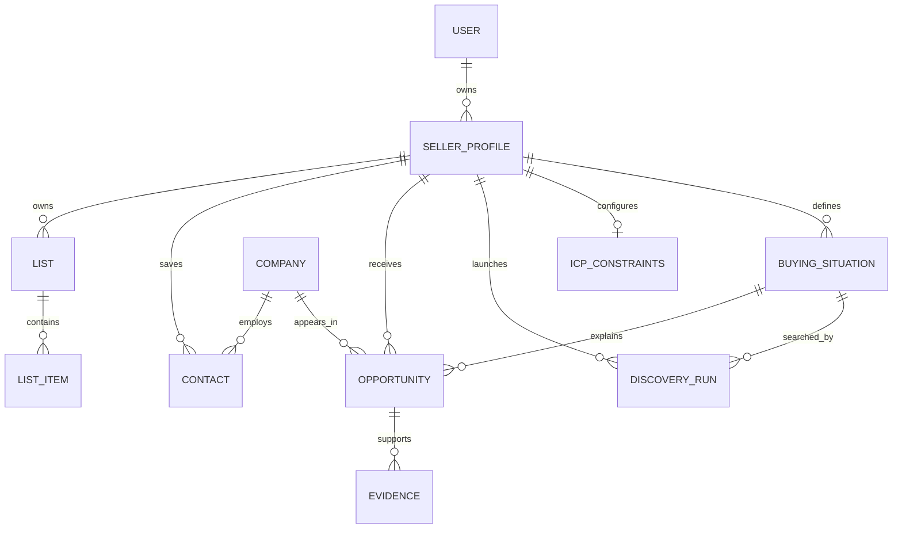
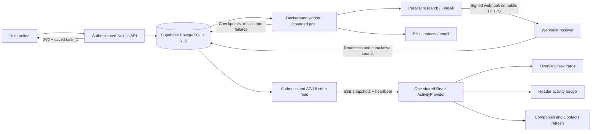
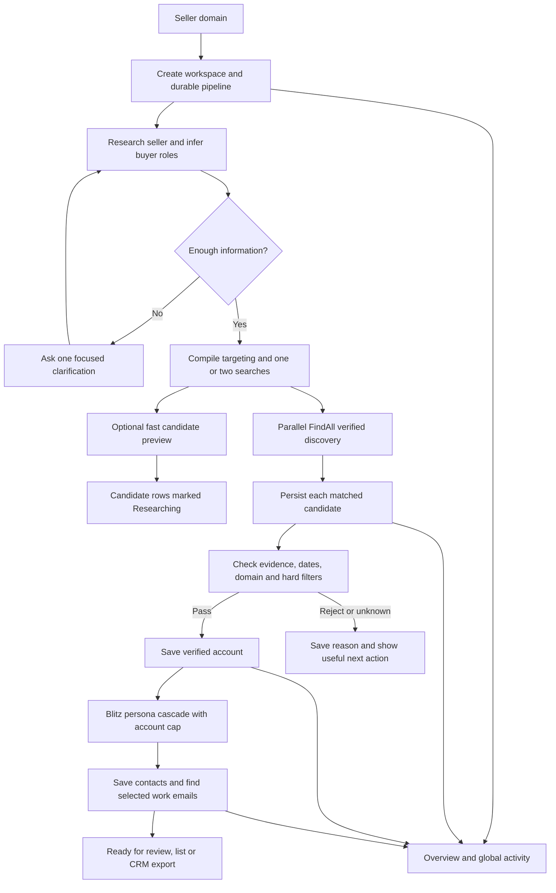

# How HotNow works

HotNow learns what a seller offers, finds companies showing relevant buying
signals, and supplies evidence and contacts. Each signed-in user can save several
seller domains as separate company workspaces.

This guide describes the current code. The cloud accounts and credentials still
need to be configured before live authentication and provider calls can be tested.

## 1. Where each part runs



The browser is the frontend. Next.js route handlers are the backend. They are in
the same project, share one server process, and use the same origin. A separate
Express, Django, or FastAPI server is not used.

Docker packages that app server and its dependencies. It does not move Supabase,
Parallel, or Blitz onto your computer. It does not automatically publish the app
to the internet. The Compose configuration binds only to this computer.

## 2. Technologies in the repository

| Technology | Purpose |
| --- | --- |
| Node.js | Runs the JavaScript backend. The Docker image uses Node 24. |
| Next.js 16.4.0 | React pages, API routes, server rendering, routing, and session proxy. |
| React / React DOM 19.3.0 | Interactive browser screens and components. |
| TypeScript | Type checking for application code. Types are not automatic runtime input validation. |
| Tailwind CSS 4 + PostCSS | Styling; Webpack builds the application. |
| Supabase JS + SSR SDKs | Authentication, browser/server clients, and database queries. |
| PostgreSQL through Supabase | Persistent relational data, constraints, indexes, and row-level security. |
| Parallel AI REST APIs | Seller research, company discovery, and fallback website search. |
| Gemini / Anthropic SDKs | Optional alternatives for generating buying signals. |
| Zod | Declared dependency; do not assume every route validates input with it. |
| pnpm + lockfile | Installs a reproducible set of dependencies. |
| PGlite | Development-only embedded PostgreSQL engine for schema/access-control tests. It is not the application's database. |
| tsx / dotenv | Development scripts and their environment loading. |
| puppeteer-core | Browser tooling used by existing development scripts, not the production app server. |
| Docker / Compose | Build the Linux image and run the app container locally. |

There is no Redis, dedicated queue server, local Postgres container, payment
processor, email campaign sender, or automatic daily scheduler in this setup.

## 3. Database: what is saved

The app uses Supabase's HTTP Data API through its SDK rather than opening a direct
PostgreSQL connection. You do not need a `DATABASE_URL` or database password in
the app's environment. Supabase uses PostgREST to expose allowed database queries.

The app tables are in a schema called `hotnow`. A schema is a namespace inside a
database, not a separate database. `auth` is managed by Supabase. `hotnow_private`
contains a trigger function for enforcing discovery limits and stays unexposed.

| Table | Stores |
| --- | --- |
| `auth.users` | Supabase-managed user identities. App profiles refer to its user ID. |
| `seller_profiles` | One workspace per user/domain: company summary, research state, contact criteria, Slack configuration. |
| `buying_situations` | Buying signals, evidence requirements, discovery objectives, enabled state. |
| `icp_constraints` | Ideal customer profile: geography, industries, exclusions, size, and match target. |
| `discovery_runs` | Provider job IDs, run state, estimated cost, timestamps, ingestion lease, notification state. |
| `companies` | Shared prospect-company identity: domain and name. This differs from the user's seller workspace. |
| `opportunities` | A prospect company matched to a workspace's buying signal; explanation and confidence. |
| `evidence` | Citation URLs, source dates, and supporting information for an opportunity. |
| `contacts` | People, job roles, LinkedIn links, priority, and email results for a workspace. |
| `contact_sourcing` | Which workspace/company pairs have already had contact sourcing attempted. |
| `lists` | Named company/contact lists in a workspace. |
| `list_items` | References to the opportunities or contacts in a list. |
| `prewarm_research` | Temporary research-task references started before signup; server access only. |
| `delivery_connections` | Per-workspace destination status for Slack, Google Sheets, Teams, and Telegram. Users can read their own rows. |
| `delivery_secrets` | Encrypted provider credentials. No access for signed-in users; the server writes them after an ownership check. |



The unique `(user_id, domain)` constraint allows one user to save multiple
different domains. Another user can save the same domain independently. Foreign
keys connect related records; additional composite keys prevent a run from using
a signal belonging to a different workspace. Lists reject items from another
workspace, including another workspace owned by the same user.

The app container needs no database volume: saved business data lives in
Supabase. Recreating the container preserves that cloud data. Database migrations
are applied separately; building an image does not run migrations.

## 4. Authentication: who is the user?

Authentication proves identity. This app delegates it to Supabase Auth.

1. Signup sends email/password to `POST /api/auth/signup`.
2. The backend uses the Supabase server key to create a pre-confirmed user.
   The current MVP does not require email verification.
3. The browser signs in through `supabase.auth.signInWithPassword`.
4. Supabase issues a session with access and refresh tokens. The SSR integration
   stores session information in cookies so server requests can identify the user.
5. `src/proxy.ts` refreshes/checks the session and redirects unauthenticated
   dashboard visits to login.
6. Protected API handlers call `requireUser()`, which asks Supabase for the user
   associated with the session and returns 401 if absent.

The application tables do not store copies of user passwords. A session token
identifies one signed-in user and expires; it is different from the project's
public key or server key. The public key by itself does not log someone in.

Google sign-in is optional. Supabase manages the OAuth flow; the app's
`/auth/callback` exchanges the returned code for a session. Google OAuth client
credentials are configured in Supabase's Google provider settings. They are not
Parallel/Blitz keys, and this app does not need them in `.env.local`.

## 5. Authorization: what may the user access?

Authorization checks permission after identity is known. There are three layers:

| Layer | Responsibility |
| --- | --- |
| Session check | A protected handler requires a signed-in user. |
| Workspace selection and ownership | Requests carry `x-hotnow-workspace`; the backend queries that ID together with the signed-in user's ID. |
| PostgreSQL row-level security (RLS) | Database policies restrict reads and writes to records belonging to that user. |

The browser remembers its selected workspace in `sessionStorage`, separately in
each tab. An HTTP-only workspace cookie supports server rendering. These values
are selectors, not proof of permission: changing an ID does not grant ownership.

RLS protects the user's records across their workspaces. Server filters select
the active workspace within those owned records. An authenticated user can access
their own several workspaces; there is no shared-team membership, invitation,
admin/member role hierarchy, or cross-user company sharing implemented.

Normal database requests use a Supabase client carrying the user session, so RLS
applies. Background ingestion and signup use an admin client with the server key.
That key bypasses RLS, so those backend paths must determine which saved job or
workspace they are processing. The secret key never belongs in browser code.

Public handlers include signup, research prewarm, discovery webhook, and health.
They have different checks from user-session endpoints. The discovery webhook
requires `PARALLEL_WEBHOOK_SECRET` and a valid HMAC signature with a timestamp
within five minutes. Without a signing secret it returns 503; invalid signatures
return 401. Background worker checks continue without webhooks.

## 6. API keys and configuration

An API key lets the app use a provider account. It is not the same as a user's
password, session token, company domain, or OAuth authorization code.

| Variable | Visibility | Purpose / requirement |
| --- | --- | --- |
| `NEXT_PUBLIC_SUPABASE_URL` | Public | Which Supabase project to contact; required for login/data. |
| `NEXT_PUBLIC_SUPABASE_ANON_KEY` | Public | Supabase publishable key, or legacy anon key. RLS still governs data access. Required. |
| `SUPABASE_SERVICE_ROLE_KEY` | Server secret | Supabase secret key, or legacy service-role key. Required for this app's signup and admin ingestion. Bypasses RLS. |
| `PARALLEL_API_KEY` | Server secret | Website research, discovery, and Parallel-based signal generation. |
| `BLITZ_API_KEY` | Server secret | Contact sourcing and email lookup. |
| `LLM_PROVIDER` | Ordinary setting | `parallel`, `gemini`, or `anthropic`. Default setup uses Parallel. |
| `GEMINI_API_KEY` | Server secret | Optional signal-generation provider when Gemini is selected. `GOOGLE_API_KEY` is also accepted by the dispatcher. |
| `ANTHROPIC_API_KEY` | Server secret | Optional signal-generation provider when Anthropic is selected. |
| `PARALLEL_WEBHOOK_SECRET` | Server secret | Verifies webhook signatures on public deployments. Different from the Parallel API key. |
| `HOTNOW_DB_SCHEMA` | Ordinary setting | Server database namespace, normally `hotnow`. |
| `NEXT_PUBLIC_HOTNOW_DB_SCHEMA` | Public setting | Matching browser namespace; normally `hotnow`. |
| `APP_URL` | Ordinary setting | Public HTTPS app URL for provider webhooks and OAuth redirects. Native local default is `http://localhost:3000`. OAuth redirect URLs are derived from this origin. |
| `DELIVERY_TOKEN_KEY` | Server secret | Encrypts Slack, Google, and Teams credentials at rest. Required before those three destinations can be connected. |
| `SLACK_CLIENT_ID` / `SLACK_CLIENT_SECRET` | Server secret | Slack app OAuth client. Not a user webhook. |
| `GOOGLE_OAUTH_CLIENT_ID` / `GOOGLE_OAUTH_CLIENT_SECRET` | Server secret | Google Cloud OAuth client for Sheets. Separate from Supabase Google sign-in. |
| `TELEGRAM_BOT_TOKEN` | Server secret | Bot token from BotFather. |
| `TELEGRAM_BOT_USERNAME` | Ordinary setting | Optional. The bot username without `@`. Discovered from Telegram when omitted. |
| `TELEGRAM_WEBHOOK_SECRET` | Server secret | Verifies Telegram's webhook header on public HTTPS. Not required for localhost polling. |
| `HOTNOW_PORT` | Compose setting | Host port for the Docker app; default 3001. |
| `DOCKER_APP_URL` | Compose setting | Value Compose supplies as the container's `APP_URL`; default `http://localhost:3001`. |

Slack, Google Sheets, Microsoft Teams, and Telegram are connected per workspace
from onboarding (after targeting) and from Settings. Slack and Google Sheets use
OAuth. Teams uses an incoming webhook. Telegram uses the app bot plus a Start
link. Tokens and webhook URLs are encrypted with `DELIVERY_TOKEN_KEY` and stored
in `delivery_secrets`, which signed-in users cannot read. A previously saved
Slack incoming webhook still delivers until it is removed or a Slack OAuth
channel is connected. See [Lead delivery](DELIVERY.md).

The names `ANON_KEY` and `SERVICE_ROLE_KEY` come from the original app; they also
accept the current Supabase publishable and secret keys. Publishable keys are
safe to include in browser code because database access is controlled by RLS.
Secret keys bypass that protection and are only for trusted backend code.

Next.js embeds `NEXT_PUBLIC_*` values into browser bundles at build time. Docker
therefore passes only public Supabase configuration to the image build. Private
keys are injected at container startup through `.env.local`, which is excluded
from the Docker build context and Git. Public-key/project changes need a rebuild;
server-key changes need container recreation with the updated environment.

## 7. What happens during a search

1. Optional prewarm starts domain-only research while the user signs up.
2. Seller research produces a company/product summary, buyers, and industries.
3. The user reviews the summary. AI proposes buying situations: observable events
   that could create demand for the seller's product.
4. The user selects signals and sets company/contact criteria.
5. The backend reserves queued discovery records and returns HTTP 202 immediately.
6. A dedicated worker launches Parallel and checks saved tasks every five seconds.
   Signed webhooks update task readiness and discovery counters on public HTTPS
   hosting. Worker checks are also used locally and for missed callbacks.
   Research automatically queues initial buying-signal generation. Overview and
   the header badge read persisted progress; navigation does not stop processing.
7. The ingestion worker checks match status, citations, and evidence freshness,
   resolves domains, and saves opportunities and supporting evidence.
8. Blitz can source decision makers and find emails. Title/seniority rules assign
   P1/P2/P3 priority; these are contact priorities, not application permission roles.
9. The user creates lists, exports CSV in their browser, and optionally sends
   lists or discovery notifications to Slack.

Discovery defaults to five matches per signal and caps the configured match
limit at fifteen. The SQL baseline enforces one active run per signal and ten
launches per user per UTC day across their workspaces. A batch of five signals
counts as five runs, and failed launch attempts also count. A database lease
coordinates competing ingestion attempts. Run a single worker process with a
bounded pool of three concurrent jobs. Contact/email batches
are separate and do not have that same daily budget mechanism.

The engine includes provider cost estimates. They are not authoritative prices,
customer subscription billing, or a guarantee of actual provider charges.

## 8. How to navigate the code

| Path | What to inspect |
| --- | --- |
| `src/app/dashboard/` | User screens: companies, contacts, signals, targeting, lists, settings. |
| `src/components/Onboarding.tsx` | Domain entry, research, signal approval, and first launch. |
| `src/components/WorkspaceSwitcher.tsx` | Add/switch company workspaces. |
| `src/lib/workspace.ts` | Browser API wrapper carrying the active workspace ID. |
| `src/app/api/` | Backend HTTP handlers. |
| `src/lib/auth-helpers.ts` | Required signed-in user checks. |
| `src/lib/supabase/` | Browser, request/session, and server-admin clients. |
| `src/lib/db/repo.ts` | Database reads and writes. |
| `src/lib/engine/` | Research, signal generation, discovery, qualification, and contact logic. |
| `src/lib/providers/` | Parallel and Blitz integrations. |
| `src/lib/llm/` | Signal-generation provider selection and SDK calls. |
| `src/lib/discovery/worker.ts` | Result ingestion, leases, and Slack completion alerts. |
| `src/lib/background/worker.ts` | Durable queue processing for research, signals, and discovery. |
| `src/app/api/activity/route.ts` | Read-only, authenticated progress across owned workspaces. |
| `supabase/migrations/001_hotnow.sql` | Tables, relationships, indexes, RLS policies, and budget trigger. |
| `scripts/test-schema.mjs` | Local database and access-control checks. |
| `Dockerfile` / `compose.yaml` | Container build and startup. |

## 9. Operating a 5–10 user pilot

All users can share one hosted Next.js app and one Supabase project. Each logs in
with their own account. The app does not need a container per person. PostgreSQL
constraints and asynchronous provider jobs support that design, but real provider
throughput and 5–10 user concurrency have not been load-tested.

Local Docker uses http://localhost:3001. That address refers to the computer a
browser is running on. Remote users need a shared HTTPS deployment with matching
Supabase Auth redirect URLs. Deploying the same image on a cloud host is a later
hosting step; Docker alone provides no public domain, TLS, backups, or API credits.

## Official references

- [Supabase API keys](https://supabase.com/docs/guides/getting-started/api-keys)
- [Supabase row-level security](https://supabase.com/docs/guides/database/postgres/row-level-security)
- [Supabase custom schemas](https://supabase.com/docs/guides/api/using-custom-schemas)
- [Next.js environment variables](https://nextjs.org/docs/app/guides/environment-variables)
- [Docker's Next.js guide](https://docs.docker.com/guides/nextjs/)

## 10. System design audit and hardening — 20 October 2026

The implementation targets the current small shared-cloud installation. It now
separates request handling, durable background execution, provider callbacks,
and frontend state delivery. Production capacity for paid AI workloads still
requires representative provider-credit and throughput tests.

### Current execution and delivery flow



Provider webhooks go to the backend. Browsers receive authenticated SSE events;
provider keys never enter the browser. The AG-UI feed uses the official
`@ag-ui/core` and `@ag-ui/encoder` packages (1.0.3). React renders task cards,
progress counters, task details, status filters, retry/stop controls, and
connection state. AG-UI defines the event contract; queue execution and
persistence are application responsibilities.

This is a read-only AG-UI `STATE_SNAPSHOT` feed, not a chat or a model execution
endpoint. Subscribing or reconnecting cannot spend credits or launch research.
The server checks stored progress every three seconds and sends snapshots only
when visible state changes. Heartbeats keep quiet connections alive. Streams
rotate after 45 seconds, reauthenticate on reconnect, and periodically verify the
session while connected. The dashboard shares one connection across its header
and pages. Offline events close it immediately; going online opens a fresh feed.
A limited HTTP fallback is available while reconnecting.

Reconnection restores current durable state, not every intermediate event.
There is no append-only event log, transactional outbox, or historical step replay
in this version. No internal model reasoning is presented as live progress.

### Section-by-section review

| Area | Finding | Implemented change | Remaining product work |
| --- | --- | --- | --- |
| Login/signup | Form labels lacked associations; error feedback needed a clear accessible target. | Associated labels, autofill hints and alert feedback. | Email verification, password reset and signup abuse controls before a public launch. |
| Onboarding | Saved settings errors could be ignored before launching discovery. | Checked API responses prevent launch after failed criteria/profile saves. Existing research resumes; users can continue in the dashboard. | Shorter guided review, quality checks on sparse research and a versioned approval record. |
| Overview | Header and panel fetched separately; progress was a basic polling list. | Shared AG-UI feed; modern status cards, filters, meaningful counters, details and connection recovery. | Durable event history and per-stage timing/latency analytics. |
| Companies | Merely viewing the page could trigger paid enrichment. Company counts also counted repeated buying signals. | Enrichment starts explicitly from Contacts; distinct company counts, signal counts, evidence context and responsive tables. | Server pagination, saved filters, richer company detail and opportunity review decisions. |
| Contacts | Browser loops drove long-running work; provider errors could become permanent empty results. | Durable queued batches; retries, stop/resume, checkpoints, explicit start, and separate not-checked/not-found email states. | Per-user credit budgets, richer data provenance and deduplication beyond LinkedIn URL. |
| Lists/details | Native prompts, repeated-add errors and missing email in contact-list exports. | Accessible save dialog; idempotent item addition; list-type validation; email export; spreadsheet-safe CSV encoding. | Rename/delete/archive flows and CRM integrations. |
| Buying signals | Failed toggles could leave the UI showing an unsaved state. | Confirm server success before committing toggles; recoverable load errors; setup link for empty state. | Signal versioning, measured precision/recall and a sample-results review before large searches. |
| Company criteria | Weak server validation and inconsistent save/load errors. | Bounded targets, typed arrays, size-range checks, checked saves and load recovery. | Server-side enforcement of criteria against discovered results; currently some criteria are provider guidance. |
| Contact criteria | Country/seniority inputs lacked validation; C-Team could be queried despite deselection. | Input validation, persisted error handling and sourcing that respects selected seniority. | Customer-specific priority rules and job-function taxonomy controls. |
| Settings/delivery | A failed save could still be followed by test delivery; arbitrary URLs were accepted. | Delivery follows successful validation/save; HTTPS Slack destinations are allowlisted; load errors expose Retry. | Delivery outbox, retry tracking and integration diagnostics. |

### Durable enrichment job guarantees

`background_jobs` is owned through `seller_profile_id` and RLS. Authenticated users
can read their jobs, but cannot directly enqueue, claim or mutate them. APIs
check ownership before using the server client. A partial unique index allows
one active job of each enrichment kind per company workspace.

The service-only `claim_background_jobs` RPC uses `FOR UPDATE SKIP LOCKED`.
Each claim receives a unique lease token and expires after three minutes.
Workers validate the token before a provider call and condition checkpoint writes
on that token. A stale worker cannot overwrite a newer claim. Jobs process one
company or person per batch, release their lease, and retain completed data.
Temporary failures retry with bounded exponential delay and jitter, up to three
consecutive attempts. Authentication/configuration failures require attention.
A cancellation request stops future batches; an external lookup already in flight
may complete. Successful contact sourcing can queue the requested email stage.

Research, signal generation and discovery still use the original persisted task
IDs/statuses and discovery ingestion lease. **Keep one worker replica for this
mixed implementation.** The new enrichment RPC is safe to claim concurrently,
but that does not make all legacy workflow stages ready for multiple replicas.
The worker's internal pool remains bounded to three concurrent operations and
checks different users fairly. Supabase calls now have a 20-second timeout.

Database writes are idempotent where supported. Evidence failures are surfaced,
and a retry repairs missing citations without duplicating saved evidence.
Cross-system exactly-once billing is not guaranteed: a provider request can
succeed before its ID is saved. Ambiguous research/discovery launches require
review rather than an automatic potentially duplicated paid launch.

### Validation and fault testing

The repository contains three offline suites: schema/RLS/leases,
background-research/webhook behavior, and enrichment/validation/CSV/evidence
recovery. `scripts/test-api.mjs` verifies real HTTP APIs against temporary cloud
accounts and removes only its own records. Its opt-in browser mode exercises all
dashboard sections, setup, failed forms, saved lists, offline recovery, task
controls and authentication. Paid provider calls and Slack sends are blocked in
the browser; synthetic queue tests run with the worker paused.

A ten-connection authenticated SSE test checks snapshot delivery under concurrent
connections. This is a local transport sample, not a ten-user paid-research load
test or a production SLA. Provider integration tests in these suites use mocks;
real signed internet webhook delivery requires a public HTTPS origin and the
Parallel signing secret.

### Priorities before broader public rollout

1. Move every workflow kind into one durable jobs model with stage versions,
   per-provider concurrency, fencing and cancellation. Then enable multiple worker
   replicas and test crash recovery across actual processes.
2. Add per-user and per-organization spend budgets, usage counters and request
   limits for signup, research, enrichment and prewarm. Enforce server-managed
   workflow fields with column/function permissions, beyond ownership RLS.
3. Add transactional webhook inbox/outbox records, stable event IDs, delivery
   deduplication, event history and replay. Replace per-stream DB checks with
   change-triggered fan-out when measured load justifies it.
4. Add server pagination and indexed filters to Companies/Contacts/Lists. Replace
   overview full-record reads with aggregate queries. Measure query count, payload
   size and p95 latency with realistic data volumes.
5. Introduce trace/job IDs, provider latency and credit metrics, failed-job alerts,
   backup/restore drills and an audited secrets-rotation process. A healthy
   container is not proof that providers have credits or that research is accurate.
6. Evaluate research quality with dated source coverage, domain accuracy, match
   precision, evidence freshness, contact fit and human review samples. Capture
   user corrections as versioned input; keep generated facts distinct from sales
   interpretation.

### Reference context

The supplied [Pump onboarding URL](https://app.pumpgtm.com/onboarding) redirected
to sign-in during inspection. Only its public entry screen was available; private
onboarding and internal architecture were not inspected or copied.

Protocol references: [AG-UI events](https://docs.ag-ui.com/concepts/events) and
[official TypeScript SDK events](https://docs.ag-ui.com/sdk/js/core/events).

Final local verification on 20 October 2026: production build/type checking,
14 offline database/RLS checks, 9 background/webhook checks, 10 reliability
checks, 18 API groups including deep browser journeys, and a separate public
landing → signup → empty onboarding test passed. Ten concurrent authenticated
SSE connections received their initial snapshot in at most approximately 1.2
seconds in the final local sample. Synthetic users and data were removed. These
checks made no paid Parallel/Blitz requests or Slack deliveries. App and worker
containers were checked healthy after cleanup.

## 11. Domain only product plan

Review date: 20 October 2026. This section proposes the next product iteration;
it does not describe features already deployed. Sections above describe the
current implementation. Public competitor material establishes advertised
behavior, not competitors' internal architecture or independently measured results.

The product promise should be: enter your company's domain and receive a small
set of prospective customers, the evidence that makes each relevant, and the
right people to contact. The submitted domain identifies the seller. Blitz
lookups normally run against the discovered customers' domains, not the seller's.

### Current prompts and execution

| Stage | Current implementation | Output and next action |
| --- | --- | --- |
| Seller research | `src/lib/engine/seller.ts`: Parallel Task, processor `core`; input is domain, website, optional seller description. The JSON schema's field descriptions act as the research prompt. | Company name, product description, target customers, problems, buyer personas, industries. The worker queues situation generation. |
| Signal planning | `src/lib/engine/situations.ts`: `SYSTEM` plus `buildPrompt`; default five situations. With Parallel configured this is another `core` Task. Gemini/Anthropic are optional alternatives. | Buyer-oriented discovery objective, observable indicators, demand hypothesis, evidence types, boolean conditions, generator recommendation. |
| Company discovery | `src/lib/engine/discovery.ts`: each enabled situation becomes a FindAll run; up to five situations per launch. ICP geography/industry preferences are appended to the objective. | Candidates and evaluated matches, with basis/citations. |
| Qualification | `src/lib/engine/qualify.ts`: application rules, not another LLM prompt. | Keep matched candidates with citations; reject dated evidence older than the default 240-day window. Resolve official domain where the URL is a known directory. |
| Ingestion | `src/lib/discovery/worker.ts`: wait for a terminal provider state, fetch results, qualify and save. | Companies, opportunities and evidence in Supabase. Rejection reasons are not persisted by this path. |
| Contact sourcing | `src/lib/engine/contacts.ts`: domain-to-LinkedIn, then separate C-Team and other senior employee searches. Default up to 12 results per call. | Deduplicated contacts with title-based P1/P2/P3 labels. Explicit contact action queues the job. |
| Work email | `src/lib/background/jobs.ts` and `src/lib/providers/blitz.ts`: email lookup for eligible saved people. | Email, a genuine no-result marker, or a retryable/permanent job error. |

The situation prompt already does several things well: it describes the buyer
in the buyer's context, connects the trigger to a product benefit, requests public
evidence, and separates the observed event from the sales interpretation. Its
blanket vendor exclusions must remain conditional: SaaS vendors and agencies are
valid buyers for many GTM products.

The current research-to-signals chain stops before discovery. Discovery-to-contact
sourcing is also a separate action. Consequently, domain submission alone does
not yet deliver an enriched prospect list.

### Specific gaps to address

| Priority | Code finding | User consequence | Proposed change |
| --- | --- | --- | --- |
| P0 | No workflow owns the full seller-to-contact sequence. | Research can finish while Companies and Contacts remain empty. | One durable pipeline with explicit stage dependencies and automatic transitions within a saved budget. |
| P0 | Inferred buyer personas are not mapped to contact criteria. Generic Sales/Operations/General Business defaults are used instead. | A security or engineering product can receive unrelated executives. | Derive a validated persona cascade from seller research and segment; use it in Blitz. |
| P0 | `withIcp` omits `sizeMin`/`sizeMax`; geography and industry are mostly soft prompt guidance. | Saved filters do not reliably control eligibility. | Compile designated hard constraints into checks; distinguish unknown size from a passed size filter. |
| P0 | Qualification rejection reasons are discarded by ingestion. | Zero results do not explain whether targeting, evidence, dates or identity failed. | Save per-candidate outcomes and an aggregated rejection summary. |
| P0 | `contact_sourcing` excludes an attempted company indefinitely, without a criteria hash or expiry. | Changing contact criteria does not make that company eligible again. | Cache by company, persona/criteria version and freshness; allow targeted refresh. |
| P1 | All results wait for terminal FindAll completion. Candidate callbacks update counters only. | First useful contacts arrive much later than the first verified company. | Persist matched candidates incrementally, qualify them, and queue bounded per-company contact jobs. |
| P1 | Domain resolution trusts any URL outside a finite aggregator list. | A regulator/news host can become the prospect domain. | Verify legal/brand identity and company-to-LinkedIn consistency; quarantine uncertain domains before enrichment. |
| P1 | Freshness uses the newest citation date; undated citations pass the date gate. | A recent article about an old event can appear timely. | Extract event date separately from publication/observation dates; label unconfirmed recency explicitly. |
| P1 | Default contact sourcing can return up to 24 people per company before deduplication. | Contact quantity and email lookups increase without proving role fit. | Start with two or three relevant contacts per account and stop when the target is filled. |
| P1 | Opportunity identity is workspace/company/situation. | A later, distinct event at the same company can update an old opportunity instead of becoming a new event. | Store an event fingerprint; deduplicate the same event but retain distinct events. |
| P1 | FindAll estimates are stored as `actual_cost`. | Operators may treat a formula as an invoiced provider charge. | Separate reserved estimate, observed provider usage and reconciled billing. Include Tasks, search and Blitz records. |

### Proposed user experience

1. Enter the seller domain and choose **Find my customers**. Create the workspace
   and pipeline immediately; navigate to Overview without waiting for research.
2. Show an editable summary as soon as available: what the seller offers, who
   normally buys it, proposed buyer roles, and the geographic assumption. Mark
   inferred targeting as inferred. Do not default every seller to the US silently.
3. Generate one or two strong starter searches. More plays are an expansion
   option rather than five expensive searches required before seeing value.
4. Show initial candidates as **Researching**. Promote to **Evidence verified**
   only after qualification. Show the first verified account immediately.
5. Source two or three suitable contacts automatically for each eligible account,
   then find work emails within the pipeline's quota. A missing email need not
   hide a useful company or LinkedIn contact.
6. Keep work active across page changes, refresh, logout and worker restarts.
   Show cumulative results and an explicit partial-success state.
7. Review, shortlist, export or send to a connected CRM. Capture **Wrong company**,
   **Wrong role**, **Old event**, **Already customer**, and **Useful** as structured
   feedback. A draft message can follow; sending is a separate product capability.

Ask one short clarification only if the website cannot establish the sales
motion. For a consumer brand, choices such as wholesale buyers, retail partners
or another audience avoid inventing B2B customers. A domain can establish public
facts; it cannot establish the user's chosen territory or campaign objective.



Fast preview and verified discovery are distinct result states. Parallel's
[Entity Search](https://docs.parallel.ai/findall-api/entity-search) returns an
initial company/person set quickly and prioritizes recall; it is not a substitute
for verifying all criteria. Trial it behind a feature flag and measure whether it
improves activation enough to justify the additional work.

### Prompt contracts for the next iteration

These are proposed HotNow templates, not copied competitor prompts. Store the
template version, schema version, model/processor, normalized input hash and
resolved dates with every run. Validate output with runtime schemas before
launching paid downstream work. Treat fetched website text as evidence data;
instructions embedded in it must not override the application prompt.

**Seller research prompt**

```text
Research the seller at {{canonical_domain}} as of {{today_utc}}.
Identify its current offering, customer types, problems solved and buyer roles.
Prefer its official product, solutions, customer-story and pricing pages.
Distinguish B2B, B2C, marketplace and mixed business models.
Separate explicitly stated facts from inferred buyer hypotheses.
Do not infer a paying customer from a logo or a third-party mention alone.
Do not confuse the seller with similarly named organizations.
Return unknown/null when evidence is insufficient. Do not invent a territory.
Return the supplied JSON schema and source references; use research basis
for field-level citations and uncertainty.
```

Recommended flat fields: canonical domain, company name, business model,
product category, product description, problems solved, buyer organization
types, buyer job titles, observed customer segments, supported geographies,
unresolved questions. Keep user corrections separate from public evidence.

Parallel recommends putting field-specific instructions, source rules and null
behavior in JSON schema descriptions. Apply the template at both the top level
and the relevant fields. See [Task best practices](https://docs.parallel.ai/task-api/best-practices).

**Targeting and persona planning prompt**

```text
Using the grounded seller profile and explicit user preferences, select a
primary buyer segment and up to two alternative segments.
For each segment, name the economic buyer, likely champion and practitioner.
Explain which seller problem each role owns.
Propose company filters, person location and ordered job-title alternatives.
Keep company headquarters geography separate from person location.
Do not exclude software firms or agencies when they are plausible buyers.
Flag assumptions that would materially change the buyer list.
Return the targeting schema. Do not start searches or alter spending limits.
```

**Signal planning and query compilation prompt**

```text
Create at most two starter buying situations for {{buyer_segment}}.
Each must have a plausible product-specific causal link, a publicly observable
event, credible evidence sources, and a configurable freshness window.
Return buyer-centric discovery text and minimal verifiable match conditions.
Separate mandatory eligibility gates from preferences used only for ranking.
Do not require private facts such as approved budget or confirmed buying intent.
Do not combine unrelated triggers as mandatory AND conditions.
Use absolute dates supplied by the application for this run.
If no defensible public trigger exists, say so; suggest a fit-only search
whose output is explicitly labeled as lacking a verified timing signal.
```

The application computes `window_start` and `window_end` for each new run.
Persist both the relative policy and the actual dates; do not reuse an old
hard-coded date window forever. For known query families, compile from reviewed
templates rather than reasoning from scratch every time.

**Example FindAll objective for a hypothetical sales tool**

```text
Find independent B2B software companies operating in {{buyer_market}} that
have an active sales development hiring initiative evidenced between
{{window_start}} and {{window_end}}. Return the hiring companies themselves,
not job boards, staffing firms or articles listing many companies.
```

Example hard checks: the entity is an actual eligible company; a cited hiring
event concerns that company within the supplied dates; explicit required ICP
constraints are satisfied. Preferences such as a favored technology or a
secondary role normally belong in scoring. A zero-result response should expose
which gates failed rather than automatically weakening mandatory targeting.

**Contact cascade example for the hypothetical sales tool**

```json
{
  "company_linkedin_url": "{{verified_prospect_company_linkedin}}",
  "cascade": [
    {
      "include_title": ["Chief Revenue Officer", "VP Sales", "Head of Sales"],
      "exclude_title": ["assistant", "intern"],
      "location": ["US"],
      "include_headline_search": false
    },
    {
      "include_title": ["Sales Development Director", "Head of Revenue Operations"],
      "exclude_title": ["assistant", "intern"],
      "location": ["US"],
      "include_headline_search": false
    }
  ],
  "max_results": 3
}
```

This illustrates `POST /v2/search/waterfall-icp-keyword`, not the current
employee-finder request. Titles and countries must be generated from the actual
seller's targeting and validated against the endpoint contract. Security sellers
would need security roles; developer tools would need engineering roles.
Do not use CEO as a universal fallback at large enterprises. Blitz documents
an ordered cascade with a shared result cap in its
[Waterfall ICP guide](https://docs.blitz-api.ai/guide/concepts/waterfall-logic).

**Opportunity explanation prompt**

```text
Use only the supplied verified account, event and contact records.
Return: why_fit, observed_event, event_date, why_now_hypothesis,
suggested_role, and one practical conversation starter.
Keep the observed fact separate from our sales hypothesis.
Never claim the company intends to purchase merely because it hired or raised.
If the event date or role relevance is unconfirmed, state that uncertainty.
Do not invent names, emails, sources, budgets or product usage.
```

### Parallel and Blitz efficiency

Use a routing policy instead of running deep research for every decision:
known URL content through Extract; simple candidate lookups through Search or
Entity Search; ambiguous seller understanding or evidence verification through
Task; verified market discovery through FindAll. Generate plans from already
retrieved evidence with a suitable structured reasoning model where evaluations
show equal quality. The current implementation uses `core` for both initial
research and Parallel-based situation planning.

For discovery, start with `base`, a small match target and one or two validated
queries. Use preview during query development or diagnostics rather than adding
it to every successful production search. Every FindAll hard condition must
pass; more conditions can sharply reduce yield. Escalate query specificity or
processor only within the saved budget and after inspecting failure reasons.

Use [Extend](https://docs.parallel.ai/findall-api/features/findall-extend) when a
query is useful and the run is eligible; it raises the target without a second
fixed charge. Completed runs must have ended with `match_limit_met`; preview,
low-yield, exhausted, failed or cancelled runs cannot simply be extended.

For net-new discovery, create a refreshed query with an exclusion set of already
worked accounts, following [Refresh Runs](https://docs.parallel.ai/findall-api/features/findall-refresh).
For new events at existing target accounts, retain a separate monitoring policy;
excluding every known domain would otherwise hide relevant new events. Evaluate
[Monitor](https://docs.parallel.ai/monitor-api/monitor-quickstart) for scheduled
changes rather than repeatedly rebuilding the entire market list. Scheduling
is a future application feature, not something this review enables.

Use a persona cascade and cap the contacts per account. Save the resolved
LinkedIn identity, contact criteria hash and checked time. Suggested starting
cache policies for evaluation: public seller facts seven days, company identity
30 days, contact roles seven days, negative contact lookups 24 hours. These are
product defaults to test, not provider freshness guarantees. A criteria change
invalidates eligibility immediately. Separate workspace-specific research and
user corrections from reusable public identity data; do not share private
prompt context across customers.

### Cost model

The [published Parallel rate card](https://docs.parallel.ai/getting-started/pricing)
lists FindAll `base` at $0.25 fixed plus $0.03 per match, `core` at $2 plus
$0.15 per match, and `pro` at $10 plus $1 per match, before optional enrichments.
Prices are time-sensitive and should be reconciled with the account agreement.

Assuming every search returns five matches, five base queries cost
`5 × ($0.25 + 5 × $0.03) = $2.00`. Two base queries cost `$0.80`, a 60% reduction
in this modeled FindAll subtotal. That is not a measured end-to-end saving:
coverage, overlapping accounts, Tasks, fallback searches, Blitz subscription
allocation and hosting are outside this comparison. The smaller batch targets
10 rather than 25 matches, so this is not an equal-volume comparison. Two core queries at the
same match count would cost `$5.50`. Do not upgrade generators silently.

At two base queries per user per day for ten users and 30 days, the same
assumptions give `$240/month` for FindAll alone. Treat that as a scenario, not a
capacity requirement or quote. A daily cap on ready accounts plus a workspace
spend budget is more meaningful than counting only search runs. An unlimited
daily run exemption does not remove provider charges.

Blitz publishes subscription plans with monthly fair-use records rather than
a universal cash price per HTTP request. Use the account's actual plan and
observed `fair_usage` values; do not multiply HTTP calls by an invented price.
Its [ABM workflow](https://docs.blitz-api.ai/guide/recipes/enrichment-workflow)
describes domain resolution, ranked people search, email enrichment and CRM
handoff. Track profiles returned, emails found and remaining records separately.

### Workflow reliability for five to ten concurrent users

Keep Next.js and Supabase, and retain a separate always-on worker. Make every
stage use the same durable claim/lease/fencing model before adding replicas.
The current enrichment jobs have leases; legacy research/discovery still need
the full multi-worker review. Set both global provider concurrency and fair
per-workspace limits; do not let ten browser sessions start unlimited searches.

Proposed additional records: `pipelines`, `pipeline_steps`, `provider_requests`,
`provider_events`, `candidate_evaluations`, `usage_ledger`, and refresh-aware
contact lookup state. Give provider requests stable application idempotency
keys. If a provider POST times out ambiguously, reconcile the request before
submitting a duplicate. Do not assume every endpoint supports idempotency headers.

Receive signed webhooks into a deduplicated event inbox and acknowledge after
durable storage. Process evidence and follow-on jobs outside the callback.
FindAll [candidate webhooks](https://docs.parallel.ai/findall-api/features/findall-webhook)
can announce individual matches. Its [SSE feed](https://docs.parallel.ai/findall-api/features/findall-sse)
also includes unmatched candidates and supports resuming with an event cursor.
Those are useful for diagnostics and incremental results. Retain a slower,
jittered status reconciliation loop for missed callbacks.

Keep the browser connected to HotNow's authenticated activity feed, never
directly to providers with secret keys. The current AG-UI snapshot stream is a
useful delivery layer; workflow durability must live in the backend. Store stage
events/counters, not fabricated progress percentages or model reasoning traces.
Consider change-driven fan-out when DB-query measurements justify it; a new
frontend framework does not resolve missing stage transitions.

### Competitor product lessons

| Product | Publicly documented pattern | Application to HotNow |
| --- | --- | --- |
| PumpGTM | Website/customer examples can seed targeting; signals narrow accounts while people targeting stays separate. Its public hiring feed has stable observations and cursors. | Start from a domain, keep account eligibility and person targeting distinct, preserve source evidence and stable event IDs. |
| Clay | Waterfall enrichment moves through providers until usable data is found. | Check saved data first, fetch missing fields next, and stop when the required contact set is ready. Add another vendor only when measured gaps justify it. |
| Unify | Plays connect signals to qualification, enrichment, sequencing and reporting. | Ship the entire account-to-action flow and attribute user outcomes to the search/signal that produced them. |
| Common Room | Buyer context, prospecting and scoring combine account and person information. | Put evidence, role fit and the next action together in the account detail view. |

Sources: [Pump targeting](https://pumpgtm.com/skills/find-icp-on-linkedin),
[Pump signal filters](https://pumpgtm.com/docs/signals),
[Pump signal events](https://pumpgtm.com/docs/signals-api),
[Clay waterfalls](https://www.clay.com/waterfall-enrichment),
[Unify Plays](https://www.unifygtm.com/product/plays),
[Common Room product](https://www.commonroom.io/).
The supplied Pump onboarding link currently presents sign-in; this review does
not claim access to its private onboarding screens. Pump's public Signals API
currently exposes hiring; other listed signal types include future categories.
Do not equate that API's scope with every feature advertised elsewhere in its app.

### Product delivery order and evaluation

| Order | Deliverable | Acceptance condition |
| --- | --- | --- |
| First | Bounded domain-to-results pipeline, persona targeting, actual hard filters, persisted rejection reasons. | One submission survives reload and yields qualified account/contact records or a specific recoverable explanation. |
| Second | Incremental matched-account ingestion, contact cascades, freshness-aware lookup state, cost ledger. | First ready account appears before the whole search finishes; reconnect/replay/retry creates no duplicate enrichment action. |
| Third | Reviewed search templates, optional candidate preview, lists/CRM handoff and structured user feedback. | Preview and verified states stay distinct; account acceptance and role-fit metrics improve on a fixed evaluation set. |
| Fourth | Opt-in monitoring, net-new discovery schedules and outcome attribution. | Repeated reads create no paid work; new events can surface at existing accounts without repeating old events. |

Start with one specific B2B seller segment and five to ten design partners.
The differentiator should be a few credible reasons to contact the right people,
with little configuration. Measure successful account decisions, not raw
contact volume. A hiring event or funding announcement is a relevance proxy,
not proof of buying intent.

Evaluate representative SaaS, services, sparse-site, agency and consumer-brand
inputs. Include sellers whose legitimate buyers are software vendors. Have a
human label company fit, true event date, official domain, contact role and
reachability on a fixed sample before and after changes. Pin prompt versions.

Track domain-to-research completion, first candidate latency, first verified
account/contact latency, account acceptance, wrong-domain rate, evidence-date
coverage, role-fit rate, email coverage, duplicate actions and cost per accepted
reachable account. Initial aspirations such as a first ready account within
three minutes or 80% reviewed account precision require measurement; they are
not current service guarantees. Test crash/replay behavior and fair scheduling
with ten concurrent workspaces under a controlled provider budget before
claiming production concurrency.
